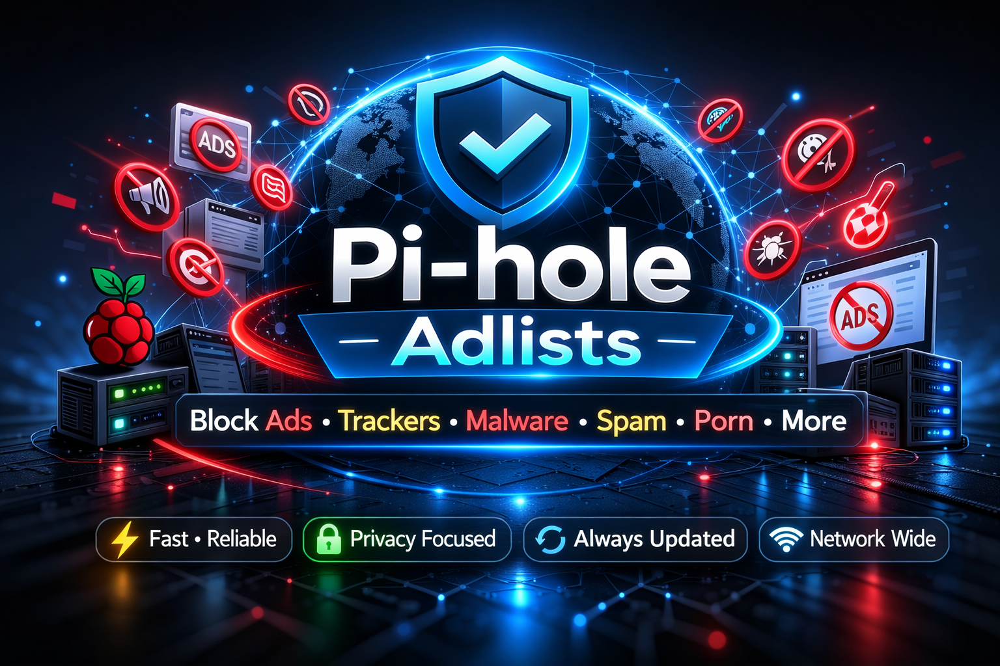

# Pi-hole Adlists

<p align="center">
  
</p>

Subscribe to one blocklist to filter ads, trackers, spam, malware, and phishing domains on devices that use your Pi-hole for DNS. The list also covers **adult content**, so choose the client groups you want it to apply to.

[Quick start](#quick-start) · [Coverage and sources](#coverage-and-sources) · [Updates](#updates) · [Report an issue](https://github.com/r0xd4n3t/pihole-adblock-lists/issues)

## Quick start

Copy this subscription URL into **Pi-hole v6**. The file contains one domain per line.

```text
https://raw.githubusercontent.com/r0xd4n3t/pihole-adblock-lists/main/pihole_adlists.txt
```

1. Sign in to your Pi-hole web interface and open **Lists** in the sidebar.
2. Paste the URL into **Address** and select **Add blocklist**.
3. If you use client groups, check the new list’s **Group assignment** and select the groups that should receive it.
4. Open **Tools → Update Gravity**, select **Update**, and wait for it to finish. Check the output for the subscription URL and the number of domains Pi-hole parsed from it.

To run the same update from a terminal on the Pi-hole host, use `pihole -g`. [Pi-hole command reference](https://docs.pi-hole.net/main/pihole-command/#gravity)

## Coverage and sources

The published list combines domains from public feeds and removes duplicates. These are some of its sources.

| Source | Coverage |
| --- | --- |
| [StevenBlack hosts](https://github.com/StevenBlack/hosts) | Advertising, tracking, and an adult-content variant |
| [PolishFiltersTeam KADhosts](https://github.com/PolishFiltersTeam/KADhosts) | Fraud and scam domains |
| [FadeMind hosts.extras](https://github.com/FadeMind/hosts.extras/tree/master/add.Spam) | Spam domains |
| [HaGeZi DNS Blocklists](https://github.com/hagezi/dns-blocklists) | Threats, tracking, and adult content |

## Updates

This repository refreshes the blocklist daily around midnight (UTC+8). The file header records the build timestamp and domain count. [Blocklist update history](https://github.com/r0xd4n3t/pihole-adblock-lists/commits/main/pihole_adlists.txt)

Pi-hole refreshes its local copy during its scheduled Gravity update, weekly by default. To pick up a change sooner, run **Update Gravity** again. [How Gravity works](https://docs.pi-hole.net/main/pihole-command/#gravity)

## Troubleshooting and contributions

- **A site stopped working?** Reproduce the problem and check **Query Log** for blocked requests from the affected device. If you identify a domain the site needs, add an exact allow rule under **Domains** for the affected group.
- **Found a false positive?** Open an issue with the blocked domain, the affected service, and what stopped working. [Report a false positive](https://github.com/r0xd4n3t/pihole-adblock-lists/issues)
- **Suggesting a source?** Include its public feed URL, the types of domains it covers, and a link to its maintenance history. Documentation fixes are welcome as pull requests.

Released under the [MIT License](LICENSE).
